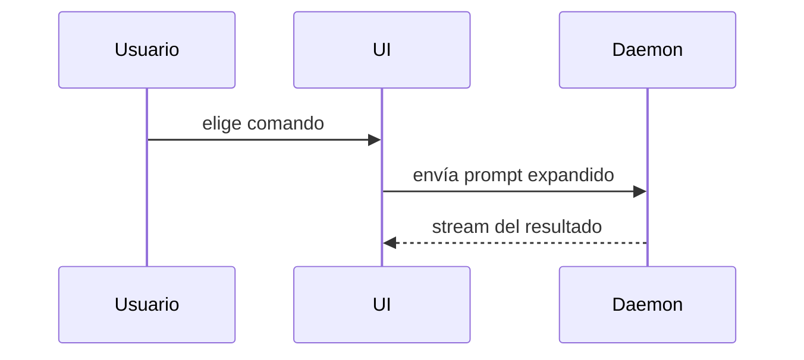

Escribe el cuerpo del PR en español con esta plantilla:

```markdown
## Resumen

<diagrama, diff-sketch o árbol>

## Evidencia

- **Antes:** <captura/salida/test fallando>
  **Después:** <captura/salida/test pasando>

## Riesgo del merge

**Puerta:** <de un solo sentido o de doble sentido>

<opcional: descripción>

**Radio de impacto:** <una palabra>

<opcional: posibles consecuencias del merge>
```

## Secciones

Sin preámbulos y con prosa breve. Usa el lenguaje de dominio del usuario de `GLOSSARY.md`.

### Resumen

Elige la vista más pequeña que deje clara la idea principal.

- Lógica o algoritmo como pseudocódigo:

```text
on(save)
  si el contenido no cambió
    devolver resultado cacheado
  escribir contenido nuevo
  devolver resultado nuevo
```

- Flujo de control en runtime como árbol de llamadas:

```text
submitForm
  createSession
    persistPrompt
    launchAgent
  navigateToSession
```

- Estructura de UI como árbol de componentes, con el estado y los límites de módulo que importen:

```text
<SessionPage> (apps/example/src/routes/session.tsx)
  useSessionEvents()
  <SessionToolbar>
    <RunSkillButton> (packages/ui)
```

- Responsabilidad de archivos o un refactor amplio como árbol de archivos poco profundo:

```text
src/
├── commands/       # interpreta acciones del usuario
├── sessions/       # dueño del estado de sesión
└── transport/      # envía peticiones a la API
```

- Interacción entre componentes, flujo de control o de datos con Mermaid:



- Usa `diff` cuando lo importante es qué cambia y la forma alrededor ya existe. Adapta la forma del diff al tema.

Cambio de componentes:

```diff
 <SessionPage>
   useSessionEvents()
   <SessionToolbar>
+    <RunSkillButton />
   <SessionTimeline>
+    <SkillResultCard />
```

Cambio de estructura de archivos:

```diff
 src/
 ├── commands/
+│   └── show-me.ts       # expande el slash command
 ├── sessions/
-└── transport.ts
+└── transport/
+    ├── client.ts
+    └── stream.ts
```

Cambio de árbol de llamadas:

```diff
 submitForm
   createSession
     persistPrompt
+    expandSkillMention
     launchAgent
-  navigateToSession
+  navigateToSession
+    subscribeToEvents
```

Cambio de estado o flujo de control:

```diff
 on(save)
-  escribir contenido
+  si el contenido no cambió
+    devolver resultado cacheado
+  escribir contenido nuevo
+  invalidar caché
```

- Muestra el bloque entero cuando casi todo es nuevo, cuando omitir contexto ocultaría a quién pertenece algo o el orden, o cuando el usuario necesita una forma final copiable:

```ts
function expandSkill(command: string): string {
  const skillName = command.slice(1);
  return `use the ${skillName} skill`;
}
```

#### Criterio

Pon cada visual junto al texto corto que apoya. Deja solo las llamadas, archivos, props, estados y límites necesarios para responder la pregunta actual o las opciones del punto en discusión.

Puedes usar una, varias, casi nunca todas. Usa tu criterio y no abrumes.

### Evidencia

Prueba concreta de que el cambio funciona, con antes y después.

Capturas: nivel S, si el entorno lo permite y el cambio es visual.

Evidencia de ejecución: nivel A. Resultados de tests, salida de consola. Muestra en pseudocódigo el test exacto que antes fallaba y ahora pasa.

### Riesgo del merge

**Puerta**: de doble sentido si se puede deshacer, de un solo sentido si no. Un PR barato de revertir es de menor riesgo. Acciones destructivas o decisiones difíciles de revertir son de un solo sentido.

**Radio de impacto**: alcance potencial del cambio. Considera todas las posibilidades: saltos de layout, roturas para consumidores, responsive en móvil, etc.
